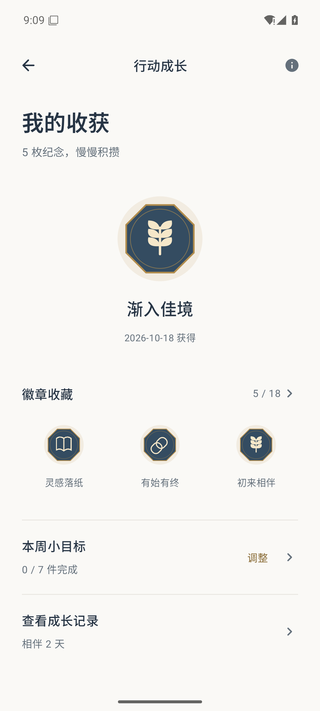
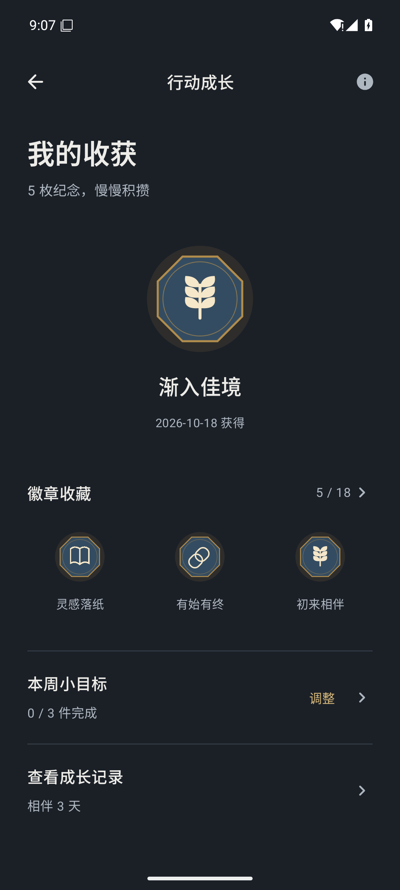
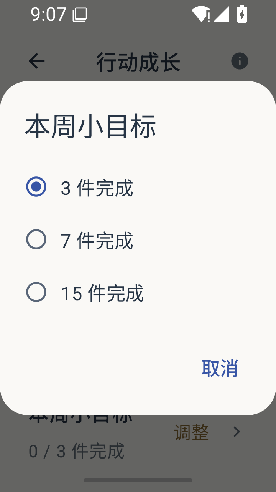

# 有序 v0.15 候选：成长收藏页

用户指出旧版不符合苹果与原神审美。本候选重新组织为徽章收藏页：分类型矢量徽章、按需展开收藏与使用日历、点击徽章查看要求、目标调整收进选择框。取消醒目等级和重复进度条；浅深色及系统栏一起检查。用户尚未认可审美，当前不发布。其他主页面尚未完成本轮重设计。

122 JVM 单测通过；最终正式候选 83 项原生检查通过，新增徽章详情、日历展开、小屏1.3倍字目标选择；12条匿名资料重启摘要一致。API36 x86_64任务专用AVD，未连接实体手机。包名、签名和业务数据格式保持。

- APK SHA256：`496447ab41c95c1ee113edbe6a90aa66e1ceacd28134936e8123424eddcb52ae`
- 源码指纹：`392bde7141f565c38346682d890e9256ccbf79d63d7338bc80b484fd5a866908`
- 探针 SHA256：`08e0e04bc3786ffafd73fbc11da2b2844a20f09b426753de348dd409a699f772`
- 完整绑定：本地 ignored `verification/redesign-release/bound-results.json`。

主截图是同一最终包在探针结束后重启并人工路径打开后的稳定渲染；目标恢复为7、使用天数恢复为匿名夹具原值。探针14截图在目标弹窗收起的系统栏颜色过渡中取样，不能当成稳定颜色结论；未修改截图。深色和大字体图片来自同一包原生探针。

