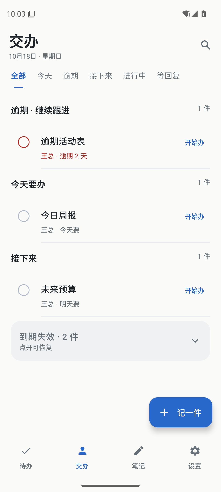
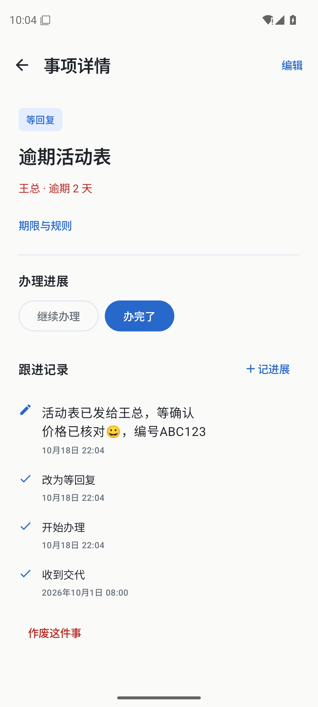
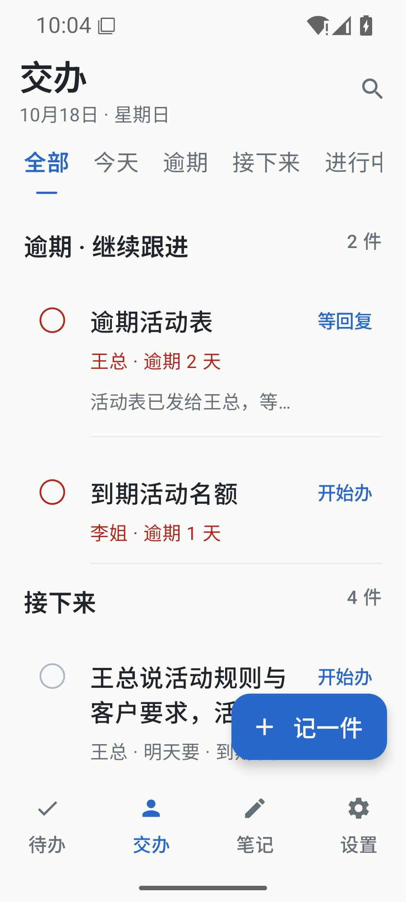
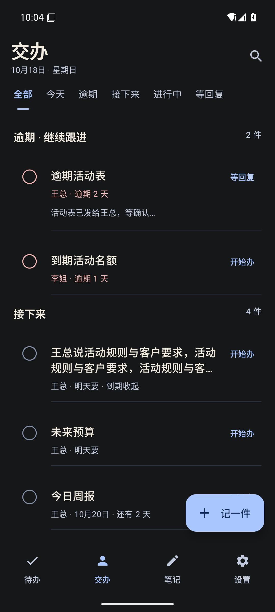

# 有序 v0.15：内容优先改版

首页直接展示待办/交办，取消重复概况数字和厚卡片；原地开始、等回复、完成与撤销仍可使用。列表随事项变化自然移动，完成提供系统触感反馈。成长移到设置，显示真实最近完成事项；笔记、详情和设置统一排版，期限规则/帮助按需展开。没有替换数据格式或签名。

122 JVM单测、最终正式包83项原生检查通过；12条匿名资料重启摘要一致。新增近期完成内容过滤断言；已有原生路径覆盖筛选真实结果、保存失败重试、草稿保护、笔记编辑归档恢复、成长收藏详情/记录展开、目标保存及最近任务隐藏恢复。浅深色、720x1280和1.3倍字已检查。设备为专用API36 x86_64模拟器，实体手机未连接；不声称用户认可审美。

APK SHA256：`df851f0a9051c56527b414924930e610f3862ef97543de1e9e16993685ba5aa9`

源码指纹：`9f1df994a3efd9cf8456e6d408147c2365f367e7e1be84dc3b6a29d5c1784b38`

探针SHA256：`57ef7a70fdb5e17de839c5acf4f9bf771e6ae0e9cfbc32a672d3cd1c608355b3`

完整本地绑定：ignored `verification/redesign-release/bound-results.json`。首轮探针把已选中的Tab点击无操作视为失败；按现有选中语义处理后完整复跑，业务行为断言不变。截图等待原生动画稳定，不修改图片。

