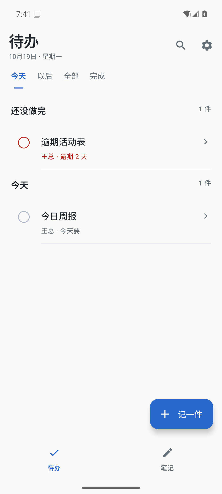
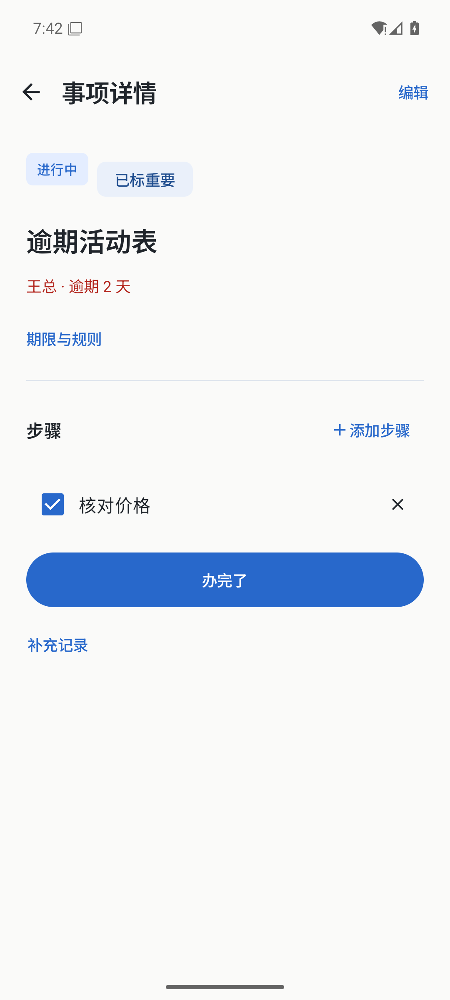
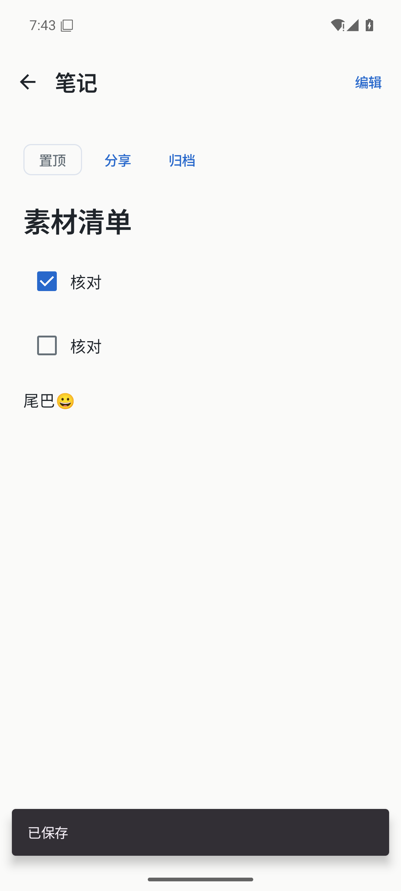
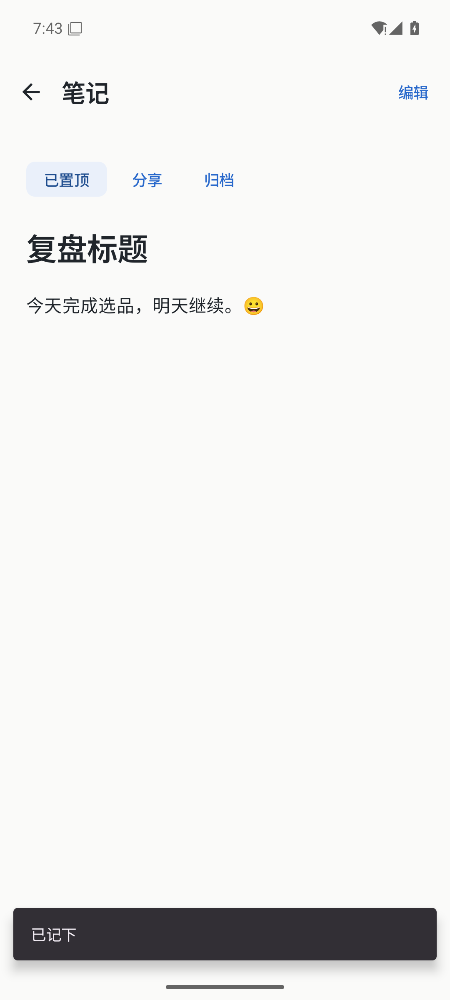

# 有序 v0.16：待办与笔记分工

待办直接处理今天、以后、全部与完成，支持重要和单层步骤。笔记独立全屏写正文、搜索正文、置顶和归档，文字清单可以逐项勾选。取消交办/按人入口，旧 DELEGATED、来源、跟进与期限规则原值保留。普通待办的办理历史收进“补充记录”。回顾展示实际完成的事，次级“日常纪念”保留成就感，不设置连续使用压力。

135 JVM（原122保留，新增13）通过；正式包110项原生断言通过。14条匿名记录强停重启后的完整摘要一致。检查覆盖旧资料、EXPIRES规则、日期/重要/步骤保存重开、编辑后完成撤销、保存失败重试、未保存草稿与新分享保护、笔记正文搜索/归档/置顶/重复清单行、实际成果回顾和最近任务隐藏恢复。

原生回归发现并修复系统主题/字号变化会重复派发旧分享的问题；最终全跑验证笔记草稿跨主题仍在、分享不重播。此前失败轮次不作为交付证据。清单选区/多行/emoji保真由纯函数单测覆盖，真实重复行勾选由原生验证。没有新增依赖或复制第三方代码。

## 绑定

- 业务/探针提交：`4549b0dbda5acfa15645d8b74b34cfbe4167561a`；后续仅文档证据变化。
- 正式包：0.16 / code16 / cn.jiaoban。
- APK SHA256：`70393929024abd15d641e24fdd1c728a5ee8a5981b137173e749e5664819d633`
- 源码指纹：`f838c80c56785beeb9921d860e207f47fac87e0b63a6963b57a5d005e30e13a5`
- 探针 SHA256：`e087c0d77c7b1a3f7bfef96f7baa043f3493425f6f89406fd3db79f1c9df89dc`
- 原签名证书 SHA256：`21b74e3e2a10e12da8284d4e6bd7d99e55b00a385215902e94d7896f7a46c967`，与v0.15一致。
- 设备：专用 Jiaoban_Redesign_API36 / emulator-5590 / API36 x86_64 / Asia/Shanghai。实际安装的APK摘要与本地产物一致。
- 小屏场景：720×1600、density320、字体1.3、深色；常规1080×2400、density420。最终恢复系统配置并关闭该专用AVD。
- 完整机器可读结果：[bound-results.json](bound-results.json)。截图全部为本次正式包匿名数据真实渲染。

实体手机未连接；手机安装/账号更新授权流程本轮未验。不能将模拟器结果或整合者看图等同于用户审美认可。旧JSON字段兼容，没有迁移或删除；旧APK不了解新增步骤字段，旧版再次保存会丢弃新字段，降级应使用原始备份。

复现命令：`python scripts/android_redesign_acceptance.py --serial emulator-5590 --adb-port 5037 --apk app/build/outputs/apk/release/app-release.apk`。脚本只允许专用AVD，写入匿名夹具，勿用于真实用户设备。

## 实际界面

