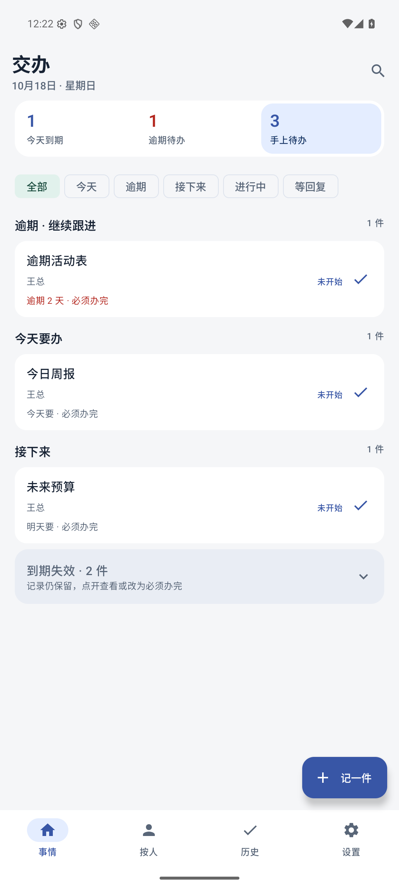
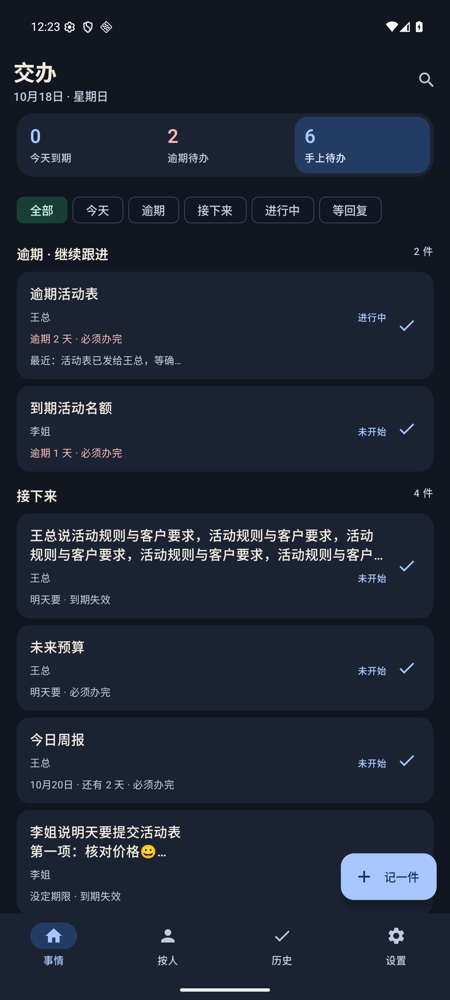
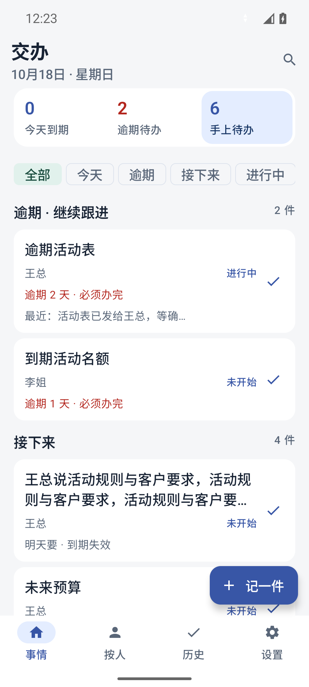

# v0.11 发布验证

首页概况合为一组，选中态同时提供颜色与读屏语义；事项卡片减少重复边框。期限、跟进、草稿、历史与本地数据格式保留。导航栏图标配置放入 API 27 资源，保留 Android 8.0 默认资源。

- 114 个 JVM 测试、正式构建与 lintRelease 通过。
- 正式 APK 原生完整回归 65 项通过：概况/工作阶段/日期筛选、搜索、到期失效、期限编辑、多行中文、详情跟进、按人、历史、长分享、未保存草稿保护、跨日刷新、大字号窄屏、深色状态栏、保存失败及重试。重启前后记录数量与 SHA256 完全一致。
- 同签名 v0.10/code 10 → v0.11/code 11 覆盖升级通过；前后 7 条合成记录 SHA256 相同。没有卸载或清数据。
- 测试环境：本次拥有的只读 Jiaoban_Redesign_API36、Android 16/API 36、x86_64、Asia/Shanghai。首次冷启动遇到 System UI 未响应，恢复系统 UI 后才执行最终通过的回归；不将启动失败记录当作通过证据。
- 较窄视口曾使两条失效记录无法同时出现在无障碍树内。测试修正为逐条滚动并确认，两条记录的业务断言均保留。
- 源码指纹：`ed2f81efabcb3bc20d68addfa44d5d9a4d043ede1188810f8ae88475496580b5`。
- 正式 APK SHA256：`0766831b9f4e0eeb78b7f6d08adedd9d4d2588868f9b7e488aa0d8a3e2e7c849`。
- 测试 APK SHA256：`e6ee24277c8fe8587cd033a54e6037a6a02cc1378fc36707cfa3769b471f8945`。
- 原签名 SHA256：`21b74e3e2a10e12da8284d4e6bd7d99e55b00a385215902e94d7896f7a46c967`。

实体手机、用户本人 GitHub 授权后的下载与系统安装未验收；Android 8.0 资源仅经 lint/资源构建核对，未运行 API 26 真机。保留现有数据，问题使用递增版本修复，不卸载或降级数据。发布脚本会重新核对源码指纹、APK 及原生通过证据，读回核验资产后才正式发布。

