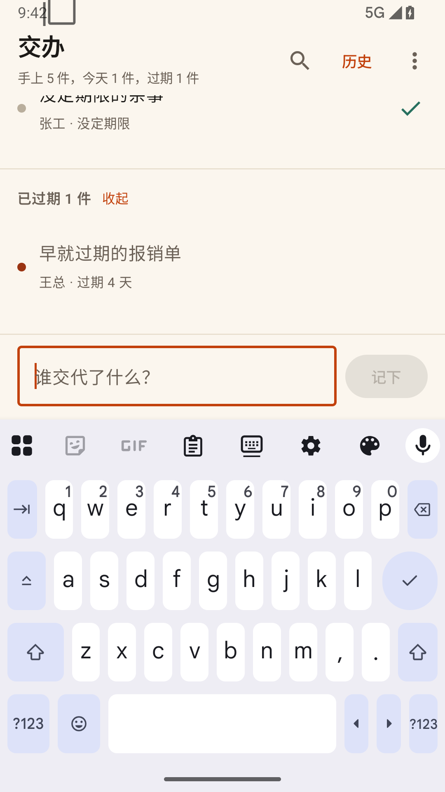
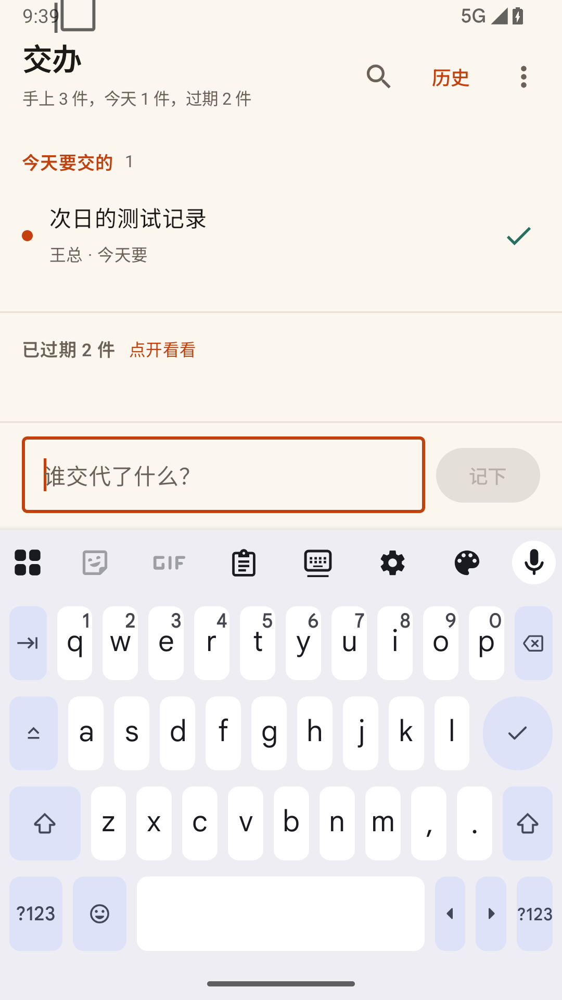

# 交办 0.8 发布验收

2026-10-12，固定 gpt-6.1-sol / high，单写手。用户手机当前版本由用户提供为 0.4；手机本身未连接，未用用户账号授权。

## 成品与环境

- 正式 APK：`Jiaoban-v0.8-universal.apk`，1,722,508 bytes。
- 包名 `cn.jiaoban`，versionName `0.8`，versionCode `8`，minSdk 26，targetSdk 36。
- SHA256：`f7bbbee04abd1b58f6d1610b9a67391e6e4a4682431835ff5bf12f7288a42e01`。
- 与发布 0.4 相同的签名证书 SHA256：`21b74e3e2a10e12da8284d4e6bd7d99e55b00a385215902e94d7896f7a46c967`。
- AVD `Jiaoban_Codex_API36`，Android API 36 / x86_64，1080×1920，密度 420，Gboard 自动弹出。
- 独立 ADB 端口 5041、设备 `127.0.0.1:5581`；没有修改共享模拟器。
- 更新联网使用测试模拟器到主机现有代理；记录和 UI 使用本地种子，不含用户记录。

## 已通过

| 路径 | 结果 |
|---|---|
| JVM 单测 | 87 项，失败/错误/跳过均为 0 |
| 调试、正式、原生测试 APK | 构建通过 |
| 完整调试包 UI | 35 项全部通过：空状态、分享、长分享全文/末尾期限、输入、重启保留、今天/有效期/过期、历史、按人、搜索及截图 |
| 正式包取消检查 | 获取真实 GitHub 设备码→取消→再次获取→再次取消→再次获取，同一 PID；未登录用户账号 |
| 正式包日期 | 7 项原生检查通过：日期、同日恢复、后台跨天、下一日数量、同一 PID、前台日期变化 |
| 0.4 → 0.8 正式包覆盖升级 | 安装成功；已有种子记录文件前后 SHA256 与条数完全一致；两版实际界面均已等待加载 |
| 发布材料 | APK 内与外置中文更新说明相同来源，SHA256 文件使用实际 APK 文件名；用户确认后正式发布，线上 3 个文件已回下载，字节与验收材料一致 |

原生探针只在测试 APK 中，使用 Android 系统启动入口与控件树，不进入成品。日期结束恢复时钟和自动校时。早期 UI 脚本有焦点、视口与旧 XML 问题，已修正并重跑全量通过；旧失败没有被当作通过。

## 限制和回退

未验收用户手机上的生命周期、本人 GitHub 授权后的私有 Release 下载、系统安装界面确认。模拟器安装和签名验证不能代替这一条。0.8 已正式发布：[Release](https://github.com/h516df/Jiaoban/releases/tag/v0.8)，目标提交 `a2a469a9d22f5c3f1be87ca17f5e26e814209391`；发布回读报告见 `published-results.json`。

Issue #2 签名备份、#3 导出/恢复、#5 系统备份策略仍待用户决定；本轮没有更改这些策略。旧版已被截断的尾巴无法自动恢复。数据格式不迁移，回退对应代码提交即可；用户手机不要卸载或清数据。

本地详细报告在整合工作区 `verification/`，摘要 JSON 同目录保留。原 canonical 0.7 草稿完整保留，未覆盖。
