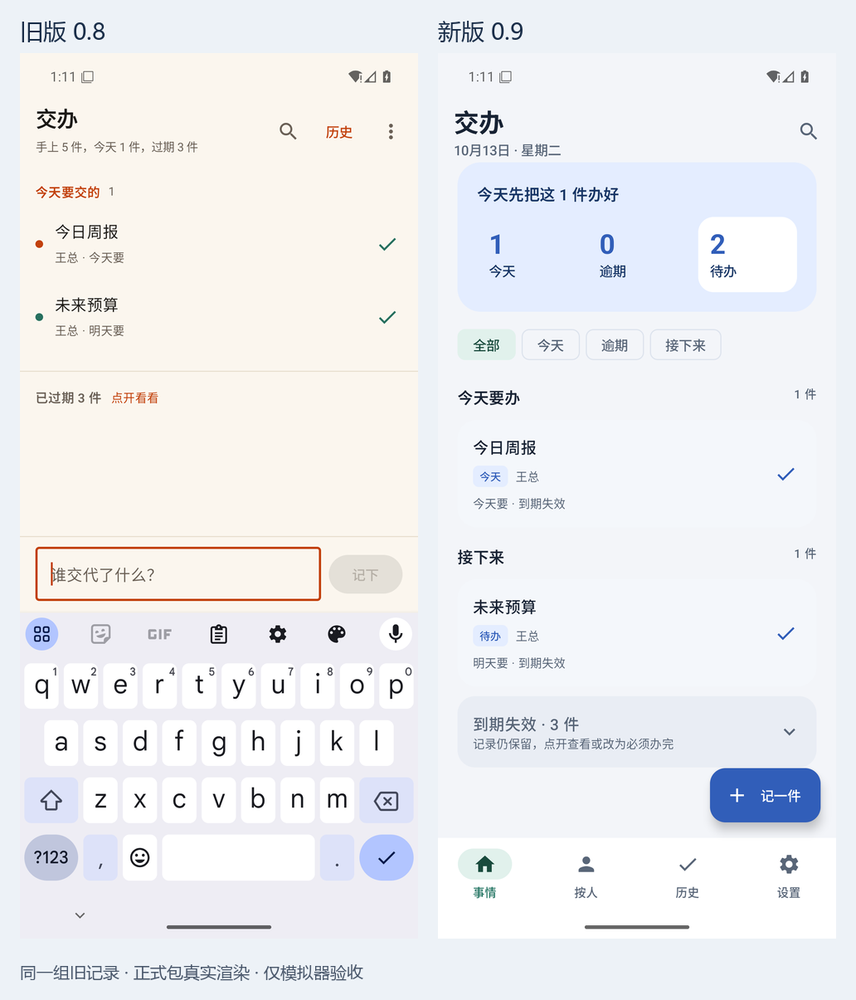
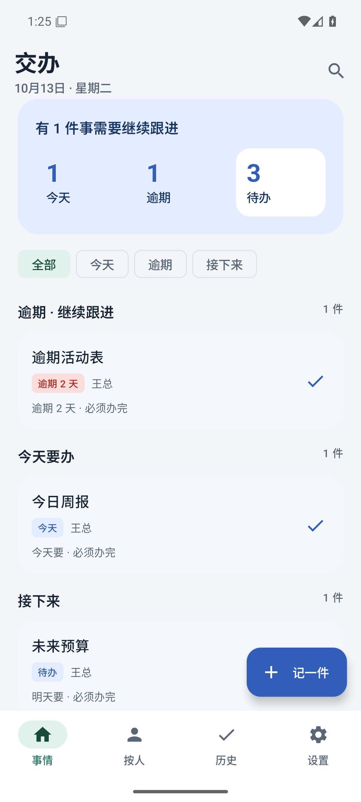

# 交办 0.9 改版验收（2026-10-13）

状态：正式包通过本机单测、原生 UI 和 0.8 覆盖升级回归，PR #13 对应最终提交 CI 通过并合并，私有 [v0.9 Release](https://github.com/h516df/Jiaoban/releases/tag/v0.9) 已发布。用户手机当前版本 0.8；真机未连接，用户本人 GitHub 授权后的下载与系统安装尚未验收。

## 对应范围与产物

- Issue #12：别人交代给我的事，快速记下、每天看该做什么、办完留记录；每条可选「必须办完」或「到期失效」。
- App 业务代码提交：`a9a4ad36dd281f00ce2342d1341850e6e334a3c6`。随后证据/脚本提交不改变 App 源码。源码指纹按源码路径、内容与构建配置计算，文本统一 LF，避免不同 checkout 的 CRLF 差异。
- App 源码指纹：`36c99183e43dfc01ef1b99e1e373d9647b962f271e37b5ed85a4d1d73b31af97`。
- 正式 APK：`Jiaoban-v0.9-universal.apk`，包名 `cn.jiaoban`，versionCode 9，1,821,016 bytes。
- APK SHA256：`c87080ecf3c7441d8797a76ee3f6c505cdf0f3c1bde50c15566c8c364ea39f57`。
- 签名证书 SHA256：`21b74e3e2a10e12da8284d4e6bd7d99e55b00a385215902e94d7896f7a46c967`，与已发布 0.8 相同。

## 实际环境与结果

专用可丢弃 AVD `Jiaoban_Redesign_API36`，Android API36 / x86_64 / Asia/Shanghai，串号 `127.0.0.1:5591`，独立 ADB5043。使用匿名夹具，未清除用户设备的数据。正式包与 androidTest 探针分别安装；探针不会进入正式 APK。验收脚本核对实际已安装 base.apk 的 SHA256。

| 验收 | 结果 | 证据 |
|---|---|---|
| JVM 逻辑单测 | 98 项通过，0 失败，0 错误 | [unit-results.json](unit-results.json) |
| 正式包真实 UI | 核心路径全部通过，重启后 9 条记录文件哈希一致 | [ui-results.json](ui-results.json) |
| 0.8→0.9 覆盖升级 | 同包名、同签名、versionCode 8→9；7 条旧记录文件哈希完全一致，升级前后 UI 实际加载；未卸载/清数据 | [upgrade-results.json](upgrade-results.json) |
| 真实 GitHub 设备授权入口 | 显示当前版本与内置说明，取消返回、同进程再次检查、重复取消/重试均通过 | [update-cancel-results.json](update-cancel-results.json) |
| 发布恢复逻辑 | 标签查询隐藏草稿时恢复原 ID、缺失、权限失败停止、重复草稿停止等 5 项通过 | [publisher-tests.json](publisher-tests.json) |
| 私有 Release 资产 | APK/中文说明/SHA256 三项逐个下载回读一致，草稿转正式成功 | [published-results.json](published-results.json) |

最终 PR head 025707183fb45f3201d3e72a9ea3e7384602167c，CI [Actions run 38285653986](https://github.com/h516df/Jiaoban/actions/runs/38285653986) 成功；squash 合并及正式 Release 目标 ebc7743319af36573abaf5fece15195e31d77cf3。合并后源码指纹重新核对一致。发布脚本的草稿恢复修正在收尾 PR 独立留痕，不改变 App 包及已验收指纹。

UI 回归断言了筛选后的实际记录与保存后的 JSON：今天/逾期/接下来、到期失效展开、改为必须办完后重返逾期列表、中文解析与人工修改交代人/日期、完整换行/长分享/emoji 尾部、日历精确选日与取消、办完/撤销/历史恢复、作废确认、按人实际结果、未保存草稿退出保护、新分享不能静默覆盖草稿、同进程后台过夜与前台跨天、窄屏 900×2000/字体 1.3、深色模式和重启。日期/字体/显示设置在测试结束后恢复。

更新取消回归在上述正式包完成覆盖升级后执行，测试未代用户授权账号，仅进入实际 GitHub 设备授权页并取消。授权之后私有 Release 的下载、校验与系统覆盖安装仍需用户本人真机验收；不能据此宣称手机更新已生效。未专项测试离线以外的网络错误状态、具体第三方 App 的分享面板及各厂商手机。

## 真实界面

同一组 0.8 旧记录升级前后；旧记录保持原「到期失效」规则，首次进入 0.9 没有偷偷改变它们：

新建记录默认必须办完，逾期留在首页；以下是包含必须办完夹具的正式包首页：

其余截图：[到期失效](02-expired.png)、[逾期](03-overdue.png)、[历史](05-history.png)、[按人](06-person.png)、[窄屏大字体](09-large-font.png)、[深色](10-dark.png)。仅保留最终通过轮次截图，早期失败现场不作为交付证据。

## 复核与回退

Issue 符合性：围绕接事、每日查看、办完留记录和每条期限策略完成；保留按人、搜索、历史与已有更新入口。未加入团队分配、账号同步或后台提醒。

工程复核：新字段缺失/未知值回退旧行为，保存完整正文，人工元数据有回归；未修改原签名和更新凭据机制；测试探针只存在于 androidTest；正式包 SHA 和源码指纹绑定 UI、升级结果。发布脚本只向已核对的私有仓库发布，先草稿上传、完整下载回读再转正式；既有已发布版本只读核对，不覆盖。

回退：不卸载、不清数据。若真机发现问题，保留本地记录，按同一签名发布更高 versionCode 的修复包。无需强行降级；旧字段兼容性不是允许安装低版本的依据。规则解析仍可能识别不准，界面允许手动改；备份/导出与签名方案仍按 #2/#3/#5 单独处理。
