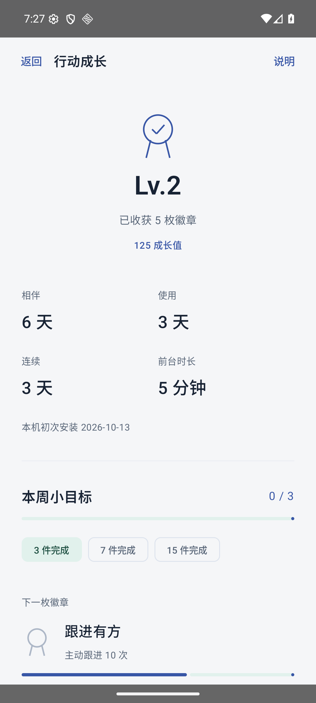

# 有序 0.14 验证

当前 Codex 为唯一实现与整合负责人。采用用户许愿式目标及留白、少文字的审美要求。交办改显示名为有序，包名、仓库、签名和数据格式不变。

- 122 项 JVM 测试通过。
- 正式 release 包在 Jiaoban_Redesign_API36 / Android36 / x86_64 上通过 80 项原生检查；待办、交办、笔记、日期、分享草稿、恢复、深色、大字体、成长目标与徽章、最近任务隐藏/还原均走实际控件。
- 重启后 12 条匿名测试记录的摘要一致。
- 成长截图为匿名夹具（测试使用日，不是用户记录）。本机统计不随业务备份迁移。
- APK SHA256：a85126a48af78631fce9f94756f0447dec81d362e76bf456aa5c791fa56588a3
- 源码指纹：ed2f5ba6e1ce78091b0d0de7ee3528c0c5e59462730638ac5b91500c05fa2783

审查：NOTE 不冒充办结，缺失 closedAt 不算当周完成；徽章按稳定 ID 保留，删除记录不会扣回；隐藏最近任务不提供保活保证。无新服务权限、账号或后台心跳。回退须发布相同签名、更高 versionCode 的兼容修复包，不能降级覆盖。实体手机、厂商启动设置与本人私有更新授权尚未验收。
